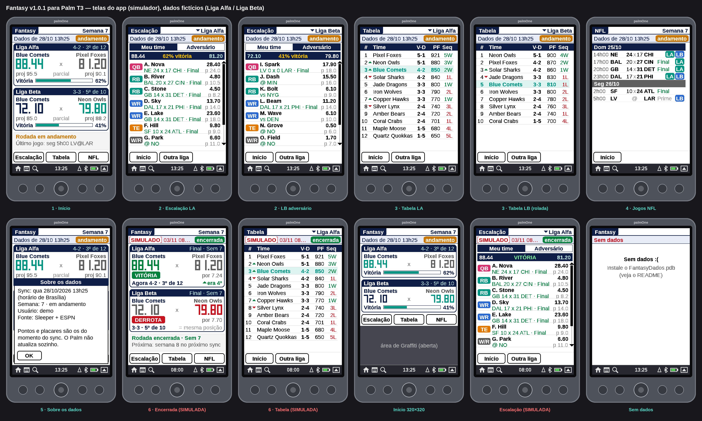

# Fantasy para Palm OS 🏈 (v1.0.1)

Resumo da rodada do **Sleeper** (fantasy de NFL) para o **Palm Tungsten T3** (Palm OS 5.2), em 320×480 com o slider aberto. Também funciona em 320×320. Pensado para rodar no **CloudpilotEmu** do iPhone.

O Palm não tem internet. O app mostra uma **foto do último sync**, o `FantasyDados.pdb` gerado no computador. Não tem "ao vivo": o placar é o do momento em que você gerou os dados.



> As imagens de prévia e os mockups usam **ligas e times fictícios** (ex.: Liga Alfa, Blue Comets). Os seus dados reais ficam só no `.pdb` que você gera localmente.

## Telas
- **Início:** até duas ligas em cartões (placar, projeção, % de vitória, recorde e posição).
- **Escalação:** titulares do seu time ou do adversário, com troca de liga.
- **Tabela:** classificação, com ▲▼ desde a rodada anterior.
- **NFL:** jogos da semana no horário de Brasília. Selos nas ligas marcam jogos com titular seu.
- **Menus:** Dados (*Sobre os dados*, *Como atualizar*) e Opções.

Sem o `FantasyDados.pdb`, o app abre e mostra "Sem dados".

## Configurar o seu usuário Sleeper
A API do Sleeper é pública (não precisa de senha), mas o gerador **não traz um usuário padrão**. Copie o exemplo e edite:

```
cp config.example.json config.local.json
# edite usuario, ligas e siglas
```

Ou exporte o caminho:

```
export FANTASY_CONFIG=/caminho/para/seu-config.json
```

Formato (`config.example.json`):

```json
{
  "usuario": "seu_usuario",
  "ligas": ["Liga Alfa", "Liga Beta"],
  "siglas": { "Liga Alfa": "LA", "Liga Beta": "LB" }
}
```

- `usuario` (obrigatório): username do Sleeper.
- `ligas` (opcional): ordem/filtro pelo nome. Se omitir, usa todas as ligas NFL do usuário (até 4), em ordem alfabética.
- `siglas` (opcional): etiquetas curtas nos jogos da NFL.

Também dá para passar na linha de comando: `--usuario fulano --ligas "Minha Liga,Outra"`.

## Gerar os dados (no computador)
Precisa de Python 3 e internet.

```
make data
# ou: python3 tools/gerar_dados.py dist/FantasyDados.pdb --config config.local.json
```

O `make data` grava `dist/FantasyDados.pdb` e uma cópia datada. **Esses arquivos não vão para o git** (estão no `.gitignore`).

## Instalar no CloudpilotEmu (iPhone/iPad)
1. Passe `Fantasy.prc` (ou `Fantasy-v1.0.1.prc`) e o seu `FantasyDados.pdb` para o iPhone.
2. Abra o CloudpilotEmu e instale os dois arquivos.
3. O ícone **Fantasy** aparece no Launcher.

Para atualizar, gere um `.pdb` novo e instale de novo (o nome interno continua `FantasyDados`).

## Compilar
Precisa de Linux com [prc-tools-remix](https://github.com/jichu4n/prc-tools-remix) e [pilrc](https://github.com/jichu4n/pilrc). O Palm OS SDK não vem no repositório — use [jichu4n/palm-os-sdk](https://github.com/jichu4n/palm-os-sdk) em `sdk/sdk-5r3`.

```
make           # dist/Fantasy.prc e dist/Fantasy-v1.0.1.prc
make data      # precisa de config.local.json / FANTASY_CONFIG
make preview   # prévias com dados fictícios (tools/gerar_demo.py)
make check
```

A versão sai da linha `VERSION` em `src/fantasy.rcp`. Creator ID **`FNFL`**.

## Limitações (v1.0.1)
- Sem ao vivo. Os dados só mudam quando você instala um `.pdb` novo.
- Mostra só os titulares. No máximo 4 ligas no arquivo e 2 cartões no Início.
- Sem preferências no Palm (usuário/ligas ficam no gerador).

App de fã, sem vínculo com Sleeper, ESPN ou NFL. Autor: Barezin78.
